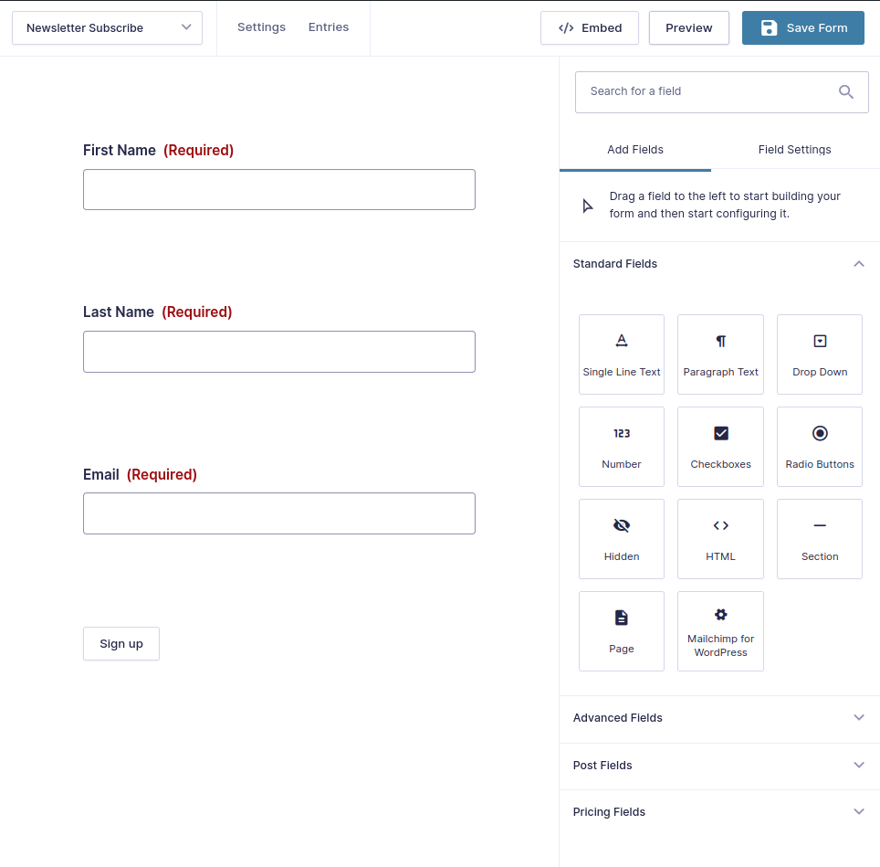
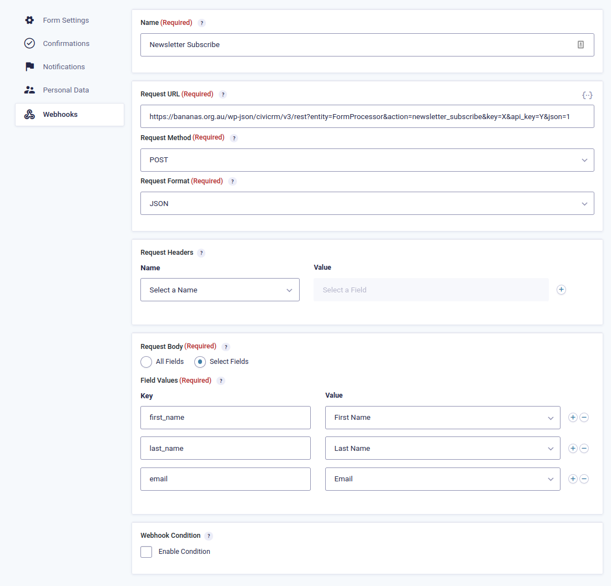
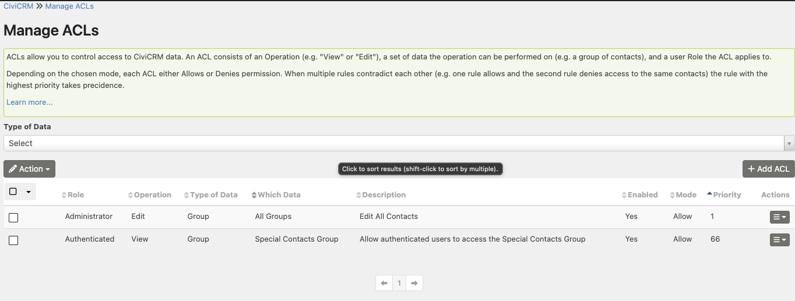

# Gravity Forms CiviCRM Integration

This is a [WordPress](https://wordpress.org) plugin that integrates the [Gravity Forms plugin](https://www.gravityforms.com/) with [CiviCRM](https://civicrm.org) using the [Form Processor extension](https://civicrm.org/extensions/form-processor).

Develop forms that integrate with CiviCRM to add common features to your website like:

* Newsletter subscription form
* Donation form
* Contact details update form
* Credit card update details form
* Recurring donation update form
* Update Activity Details form

# Requirements

* [CiviCRM](https://civicrm.org/download), either installed on the same WordPress site as this plugin, or a remote CiviCRM installation connected with the [Connector to CiviCRM with CiviMcRestFace plugin (CMRF)](https://github.com/CiviMRF/civimcrestface-wordpress). See [Remote CiviCRM Integration using WordPress CiviMcRestFace](#remote-civicrm-integration-using-wordpress-civimcrestface).
* Integration with the CiviCRM Form Processor uses Web Hooks, which requires the [Gravity Forms Webhooks Add-on](https://www.gravityforms.com/add-ons/webhooks/). This add-on is currently bundled with the [Gravity Forms Elite License](https://www.gravityforms.com/elite-license-plan/)

# Setting up a Newsletter Subscription form using Gravity Forms and CiviCRM

Use the following steps to set up a _Newsletter Subscription_ form using the example configuration provided.

1. In WordPress, install and enable this plugin.
2. On the CiviCRM Extensions page, install the following Extensions:
    1. [Action Provider](https://lab.civicrm.org/extensions/action-provider)
    2. [Form Processor](https://lab.civicrm.org/extensions/form-processor)
    3. [API Key Management](https://lab.civicrm.org/extensions/apikey)
3. In CiviCRM, locate the CiviCRM "System User" Contact. This is the user account used to execute CiviCRM cron and scheduled jobs. If you do not have such a user, then best to create one is now as this will be used by default for processing the form submissions; this user must have a corresponding WordPress user account.
4. Open this CiviCRM Contact and click on the **API Key** tab.
5. Generate a **User API Key** and copy the **Site API Key**.
6. In WordPress, open Gravity Forms and import the example Gravity Form, [gravityforms-newsletter_subscribe.json](example/gravityforms-newsletter_subscribe.json)
7. Open the imported Gravity Form, the following form should be displayed. 
8. Click on **Webhooks**
9. Add a new **Webhook**
10. Configure the **Webhook**
11. Configure the Webhook as shown below. 
12. In the **Request URL** parameters for the Webhook, replace the following values:
    1. `{rest_api_url}` - This Gravity Forms, Webhook, Merge Tag will return the WordPress REST endpoint, for example: https://bananas.org.au/wp-json/. Alternatively use `{gf_civicrm_rest_url}`, see [{gf_civicrm_rest_url} custom merge tag](#gf_civicrm_rest_url-custom-merge-tag).
    3. `key`, enter the **CiviCRM Site API Key**. It is recommended to use the CiviCRM Site Key field in the Gravity Forms CiviCRM Settings page (`/wp-admin/admin.php?page=gf_settings&subview=gf-civicrm`) so the key can remain consistent across all Request URLs by using the `{gf_civicrm_site_key}` merge tag.
    4. `api_key`, enter the **CiviCRM API Key** It is recommended to use the CiviCRM API Key field in the Gravity Forms CiviCRM Settings page (`/wp-admin/admin.php?page=gf_settings&subview=gf-civicrm`) so the key can remain consistent across all Request URLs by using the `{gf_civicrm_api_key}` merge tag.
    5.  Example URL: `{rest_api_url}civicrm/v3/rest?entity=FormProcessor&action=newsletter_subscribe&key={gf_civicrm_site_key}&api_key={gf_civicrm_api_key}&json=1`
    6. `{gf_civicrm_site_key}` and `{gf_civicrm_api_key}` are only replaced in Gravity Forms Webhooks requests (Request URL, headers and body). Anywhere else, such as confirmations, notifications or field default values, they are output as-is, so the keys cannot be exposed.
13. Save the Webhook
14. In CiviCRM, go to the Administer > Automation > Form Processors page, `/wp-admin/admin.php?page=CiviCRM&q=civicrm%2Fadmin%2Fautomation%2Fformprocessor%2F#/formprocessors`
15. Import example Form Processor, [civicrm-form-processor-newsletter_subscribe.json](example/civicrm-form-processor-newsletter_subscribe.json)
16. **Edit** the imported Form Processor. Verify that it has the required fields:
    1. first_name
    2. last_name
    3. email
17. In the Form Processor, edit the **Add to group** action and select the CiviCRM Group that the Contact should be subscribed to for the **Contact: Add to group**. This option must be set for the **Add to group** action to succeed.
18. Note that the Form Processor has the name, **newsletter_subscribe** which used in the Webhook, Request URL. This is how the Webhook is **connected** to this Form Processor.
19. **Save** the Form Processor.
20. In WordPress, embed the Gravity Form in a new page.
21. Open a new Web Browser window, not logged into the website. Go to the new page and submit the Gravity Form.
22. In CiviCRM, confirm that the Contact was created and that the Contact was subscribed to the Group in CiviCRM.

# Using the Default Form Processor option

You can optionally set a default form processor for each form. 

If set, 

* `Default / $processor / $field` options will appear in the Merge Tags selector.
* Using the Merge Tag format `{civicrm_fp.default_fp.$field}` in the **Default Value** will pull the value from the default form processor.
* The CiviCRM Source option list will include a `DEFAULT Form Processor` option group. This will be populated by the inputs of the default form processor.

To set a default form processor.

1. Open your form's CiviCRM form settings page.
2. Insert your form processor's name in the *Default Form Processor* field.
3. Save your settings.


# Using Merge Tags for default field values

When setting up your field in Gravity Forms, you can use a Merge Tag of the form `{civicrm_fp.$processor.$field}` in the **Default Value** section of your Field's Advanced settings.

In the _Newsletter Subscription_ above for example, you could fill in the Email field with the current user's email address recorded in CiviCRM, you would use `{civicrm_fp.newsletter_subscribe.email}`, and set up the Retrieval of Defaults accordingly for the newsletter_subscribe Form Processor in CiviCRM.

The "Retrieval criteria for default data" specified in the form processor will be mapped to URL parameters when your Gravity Form is displayed to your users, such that if you create a criterion named `cid` to retrieve contact details by ID, you'd be able to specify contact ID _1234_ with a request like:

`https://bananas.org.au/newsletter_subscribe?cid=1234`

# Using options defined in CiviCRM for choices in your form fields

For Gravity Forms fields that support setting choices (e.g. Drop Down, Checkboxes, Radio Buttons), you may use predefined option lists set in CiviCRM. These either can use Option Groups defined in CiviCRM directly or may be defined by your Form Processor (recommended):

1. Edit your Form Processor and add an input of one of the supported types:
    - Yes/No as Option List
    - Option Group
    - Custom Options
    - Mailing Group
    - Tags
2. Save your Form Processor
3. Edit your Gravity form and add one of these types of field:
    - Checkboxes or Multi Select (under Advanced Fields) for multiple option selection
    - Radio Buttons or Drop Down to allow selection of a single option
3. Under the General settings for your field, open the CiviCRM Source selection.
4. Locate your Form Processor in the option list headings, and under it, select the field you defined in step 1.
5. Press the "Edit Choices" button, and select "show values" - this will allow the CiviCRM options to be mapped directly.
   Note that the Choices will not appear filled from CiviCRM until you save the form and reload - also, if you change any options here your changes will be replaced with options filled from CiviCRM, so if you need to make any changes to the available options, including order, it is important to make them in the *Form Processor* configuration
6. Save the Form and either Preview or embed it to see the changes

**Default Value**: If you set defaults for the Form Processor input used as a "CiviCRM Source", these will be applied when the form is loaded, including any Retrieval criteria specified in the URL parameters. No need to set the Default Value attribute for the Gravity Form Field.

# Listing the contacts in a CiviCRM Group

The **CiviCRM Group Contact Select** field (under Advanced Fields) lists the contacts in a CiviCRM Group or Saved Search as a drop down, so the person filling in the form can choose one. Choose the group or saved search in the field's **CiviCRM Source Group** setting.

## Permissions

The field only lists the contacts that the person viewing the form is allowed to see in CiviCRM. The check is made on the contacts themselves, using CiviCRM's contact permissions and ACLs, in the same way as anywhere else contacts are read from CiviCRM:

* A user with the **view all contacts** (or **edit all contacts**) permission sees every contact in the source.
* Everyone else sees only the contacts in groups that their CiviCRM ACLs let them view, plus their own contact if they have the **view my contact** permission. This includes visitors who are not logged in.
* Deleted contacts are never listed.

If the person viewing the form may not see any of the source's contacts, the field shows "No Contacts in this Group".

### Group sources

To show a group's contacts to logged-in users, add an ACL in CiviCRM (**Administer > Users and Permissions > Permissions (Access Control) > Manage ACLs**):

* **Role**: Authenticated
* **Operation**: View
* **Type of Data**: Group
* **Which Data**: the group used by the field
* **Mode**: Allow



An ACL on a different group only shows the contacts that are in both groups.

Anyone the ACL applies to can see these contacts anywhere in CiviCRM, not just in this field, so only use a group whose contacts may be shown to those users. Use a group that holds only the contacts the field should list, rather than a broad group.

### Saved Search sources

A saved search has no permissions of its own, and the field does not use its search displays, so display settings (such as bypassing permissions) have no effect here. The field takes the saved search's criteria and runs them as a contact search for the person viewing the form, with the contact permissions above applied. The field lists the contacts that match the saved search **and** that the person viewing the form may see.

CiviCRM ACLs are granted on groups, not saved searches. To show a saved search's contacts to users without **view all contacts**, add an ACL (as above) on a group that contains those contacts. The simplest way is to create a smart group from the same saved search, and add the ACL on that smart group.

For example, a saved search matches 50 contacts, and the only ACL lets the Authenticated role view a group called "Special Contacts Group":

* A logged-in user without **view all contacts** sees only those of the 50 who are also in Special Contacts Group.
* A user with **view all contacts** sees all 50.
* A visitor who is not logged in sees none.

Only SearchKit saved searches of contacts can be used.

### Form editor

When editing the field, the **CiviCRM Source Group** setting lists the titles of all active CiviCRM groups and all saved searches of contacts, to anyone who can edit Gravity Forms, whatever their CiviCRM permissions. It does not list any contacts. Previewing the form shows only the contacts the editor may see.

### Remote CiviCRM connections

On a remote CiviCRM connection, the permissions and ACLs that apply are those of the connection profile's API user, not the person viewing the form, so every visitor sees the same contacts.

### Turning off the permission checks

Sites that need the field to list every contact in the source regardless of permissions can turn the checks off:

```php
add_filter( 'gf_civicrm_group_contact_select_check_permissions', '__return_false' );
```

***With this filter, the field shows the name of every contact in the source to everyone who can see the form.***

# Processing form submissions as a specific Contact

Any Form Processor that should record actions as a specific Contact must implement checksum validation as part of the Form Processor.

1. Include fields in the Form Processor that are used for the checksum validation
    - `cid` for the Contact ID - this should be a **numeric input** (no decimal) in Form Processor
    - `cs` for the Checksum - this should be a **long text input** in Form Processor
2. These fields should also be included on the Gravity Form as hidden fields. Use the Merge Tags from the Form Processor as defaults and optionally, if you want to use a Contact checksum URL for the form (eg. ?cs=xxx&cid=123), enable for both these fields the option to set the value from the URL parameter (cs and cid).
3. Inside the Form processor "Retrieval of defaults" settings, use the "Contact: get contact ID of the currently logged in user" and "Contact: generate checksum" actions to provide default values to these fields
4. You can also use the "Retrieval criteria for default data" to add `cid` and `cs` criteria supporting checksum links generated from CiviCRM schedule reminders.
    - Works with any link that includes `?{contact.checksum}&cid={contact.id}` on the page with the Gravity Form.
    - Use the "Contact: validate checksum" action in Retrieval of Details to authenticate the link.
5. As part of the Form Processor actions, you must use the "Contact: validate checksum" to authenticate the Contact ID and checksum used to submit the form.
6. For Form Processors that *must* be processed on behalf of an existing contact, also use the "Contact: Validate checksum" action as part of the Form Processor Validation actions

An example of this setup is available,
- Import Gravity form: [gravityforms-update_card.json](example/gravityforms-update_card.json)
- Import Form Processor: [civicrm-form-processor-update_card.json](example/civicrm-form-processor-update_card.json)

## {civicrm_api_key} - CiviCRM API Key merge tag (Deprecated)

This method is **deprecated**, instead provide a CiviCRM API Key for a CiviCRM Contact with sufficient permissions to execute the Form Processor or use the method described in the above section, _Processing form submissions as a specific Contact_.

The `{civicrm_api_key}` Merge Tag will return the CiviCRM API Key for the user that submitted the form.

# Importing and Exporting CiviCRM Integrated Gravity Forms

Gravity Forms with Webhook Feeds that call CiviCRM Form Processors can be now be exported onto your file system all at once.

To configure the base Import/Export Directory,

1. Go to Forms > Settings. Open the CiviCRM subview.
1. Edit the Import/Export Directory setting. This is relative to the root directory.

To export your Forms, Feeds, and Form Processors,

1. Go to Forms > Import/Export. Open the Export GF CiviCRM subview.
1. Select the Forms you wish to export.
1. Click on the "Export Selected" button to begin the export. This will export the Form, related Feeds, and related Form Processors to the Import/Export Directory.

These exported files can then be imported from the Import/Export Directory. **CAUTION:** This will overwrite any existing data that you import into. Take a backup before doing an import.

1. Go to Forms > Import/Export. Open the Import GF CiviCRM subview.
1. Select the Forms you wish to import. This will include related Feeds.
    - You can select an existing form to import into. **CAUTION:** This will overwrite all the data on the existing form. Take a backup before doing this.
    - You can choose to create a new form from the import file.
1. Select the Form Processors you wish to import. **CAUTION:** If a form processor exists with the same name on your system, it will be overwritten by the import file on import. Take a backup before doing this.
1. Click on the "Import Selected" button to begin the import. This will import the selected Forms and their related Feeds, and selected Form Processors.

## Protecting the Import/Export Directory

Exported files can contain feed and form processor settings, so the Import/Export Directory must not be publicly readable. The plugin writes an `.htaccess` (Apache) and an `index.php` into the base directory and each export subdirectory. **nginx ignores `.htaccess`**, as does Apache when `AllowOverride` is disabled, so on those servers add a rule to your server configuration. For nginx, in the site's `server` block and above any generic static file or `.json` location rules, using the path from your Import/Export Directory setting:

```nginx
location ~* ^/CRM/gf-civicrm-exports/ {
    deny all;
    return 404;
}
```

Reload nginx afterwards. The Import GF CiviCRM and Export GF CiviCRM screens check the directory over HTTP and show a warning if it is still publicly readable. The result is cached for up to an hour.

# Remote CiviCRM Integration using WordPress CiviMcRestFace

This plugin can support connections to a remote CiviCRM installation with the aid of the [Connector to CiviCRM with CiviMcRestFace plugin (CMRF)](https://github.com/CiviMRF/civimcrestface-wordpress). Refer to the installation notes there.

See the [DEVELOPERS documentation](DEVELOPERS.md) for developer notes, including the recommended GF CiviCRM Companion Extension, which lets the remote API user work with fewer CiviCRM permissions.

## Configuring REST Connection Profiles

Once you have installed CMRF, you must configure a REST Connection profile and select it for use.

1. Go to Settings > CiviCRM McRestFace Connections.
1. Add a new connection profile to your desired CiviCRM installation and save it.
1. Go to Forms > Settings. Open the CiviCRM subview.
1. Under **CiviCRM REST Connection Profile**, choose a connection profile to use. This will be the default connection profile for all forms.
1. When you select a connection profile, a series of **preflight checks** will run to confirm a baseline connection to CiviCRM. This will help identify if a connection can be established and if the nominated API user who owns the API key provided has sufficient permissions for core CiviCRM API calls used by this plugin.
1. **Save** your changes.

## Default values on remote connections

On a remote connection, every API call runs as the CiviCRM user that owns the connection profile's API key, not as the person viewing the form. This affects form processors used for default values (`{civicrm_fp.$processor.$field}` merge tags):

* CiviCRM does not know who is logged in to WordPress, so "Contact: get contact ID of the currently logged in user" returns the API user, and the form would be pre-filled with the API user's details.
* The form processor's permission is checked against the API user, not the person viewing the form.

For a form processor used for default values on a remote connection, identify the contact with `cid` and `cs` retrieval criteria from the URL, validated with the "Contact: validate checksum" action (see [Processing form submissions as a specific Contact](#processing-form-submissions-as-a-specific-contact)). Do not use actions that depend on the logged-in user.

## {gf_civicrm_rest_url} custom merge tag

You may use `{gf_civicrm_rest_url}` in your webhook **Request URL**. This will output either the full v3 REST URL from the selected connection profile, or the same contents as `{rest_api_url}` if not found.

Note that `{rest_api_url}` will not include `civicrm/v3/rest` at the end of the API URL, but `{gf_civicrm_rest_url}` will.

# Troubleshooting

To troubleshoot this integration, enable the Gravity Forms Logging on the page `/wp-admin/admin.php?page=gf_settings&subview=settings` and then check the Web Hooks logs when the Gravity Form is submitted. Logs are available on this page, `/wp-admin/admin.php?page=gf_settings&subview=gravityformslogging`
This should help you identify the cause of most issues integrating the Gravity Form and CiviCRM.

CiviCRM expects permalink settings to be set to "Post name" by default in order to address the `wp-json` directory. Enable this setting on the page `/wp-admin/options-permalink.php` if it is not set already.

If you are a Web Developer and know how to set up and use [PHP Xdebug](https://xdebug.org/), it is useful to debug the Form Processor called by the Web Hook by appending &XDEBUG_SESSION=1 to the Web Hook URL in the Gravity Forms, Webhooks Feeds. This will trigger the Xdebug session to start.

## Logging Webhook Results

Webhook responses will be saved onto each entry's meta. You can view the response in the UI under Webhook Result when viewing a single entry. This can be useful as part of debugging failed webhook requests.

## Webhook Alerts

Sometimes webhook requests fail. They may also appear to succeed, but return an error from the Form Processor. You can choose to receive email alert notifications when this happens by enabling Webhook Alerts on this page `/wp-admin/admin.php?page=gf_settings&subview=gf-civicrm`. Provide an email address to direct alerts.

The alert email will include the error message, the Feed, and the Entry ID.

## CiviCRM Source

Fields that have access to CiviCRM Source to populate options will only work when using the Checkboxes or Radio fields. Multiple Choice fields were introduced into Gravity Forms later, and are currently not supported by this plugin.

# License

    This program is free software: you can redistribute it and/or modify
    it under the terms of the GNU General Public License as published by
    the Free Software Foundation, either version 3 of the License, or
    (at your option) any later version.

    This program is distributed in the hope that it will be useful,
    but WITHOUT ANY WARRANTY; without even the implied warranty of
    MERCHANTABILITY or FITNESS FOR A PARTICULAR PURPOSE.  See the
    GNU General Public License for more details.

    You should have received a copy of the GNU General Public License
    along with this program.  If not, see https://www.gnu.org/licenses/.

# About the Authors

This WordPress plugin was developed by the team at
[Agileware](https://agileware.com.au).

[Agileware](https://agileware.com.au) provide a range of WordPress and CiviCRM development services
including:

* CiviCRM migration
* CiviCRM integration
* CiviCRM extension development
* CiviCRM support
* CiviCRM hosting
* CiviCRM remote training services

Support your Australian [CiviCRM](https://civicrm.org) developers, [contact
Agileware](https://agileware.com.au/contact) today!


