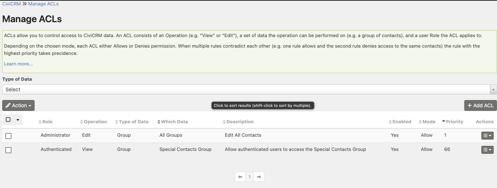

# CiviCRM Group Contact Select field

The **CiviCRM Group Contact Select** field (under Advanced Fields) lists the contacts in a CiviCRM Group or Saved Search as a drop down, so the person filling in the form can choose one. Choose the group or saved search in the field's **CiviCRM Source Group** setting.

## Permissions

The field only lists the contacts that the person viewing the form is allowed to see in CiviCRM. The check is made on the contacts themselves, using CiviCRM's contact permissions and ACLs, in the same way as anywhere else contacts are read from CiviCRM:

* A user with the **view all contacts** (or **edit all contacts**) permission sees every contact in the source.
* Everyone else sees only the contacts in groups that their CiviCRM ACLs let them view, plus their own contact if they have the **view my contact** permission. This includes visitors who are not logged in.
* Deleted contacts are never listed.

If the person viewing the form may not see any of the source's contacts, the field shows "No Contacts in this Group".

### Group sources

To show a group's contacts to logged-in users, add an ACL in CiviCRM (**Administer > Users and Permissions > Permissions (Access Control) > Manage ACLs**):

* **Role**: Authenticated
* **Operation**: View
* **Type of Data**: Group
* **Which Data**: the group used by the field
* **Mode**: Allow



To also show the group's contacts to visitors who are not logged in, for example on a public form, use the **Everybody** role instead of Authenticated.

To show them to only some logged-in users, create an ACL role, assign it to those users (**Administer > Users and Permissions > Permissions (Access Control) > Assign Users to Roles**), and use that role in the ACL instead of Authenticated. Logged-in users without the role see "No Contacts in this Group".

If the contacts do not appear straight after adding an ACL, clear CiviCRM's caches (**Administer > System Settings > Cleanup Caches and Update Paths**). CiviCRM caches each user's ACL results.

An ACL on a different group only shows the contacts that are in both groups.

Anyone the ACL applies to can see these contacts anywhere in CiviCRM, not just in this field, so only use a group whose contacts may be shown to those users. Use a group that holds only the contacts the field should list, rather than a broad group.

### Saved Search sources

A saved search has no permissions of its own, and the field does not use its search displays, so display settings (such as bypassing permissions) have no effect here. The field takes the saved search's criteria and runs them as a contact search for the person viewing the form, with the contact permissions above applied. The field lists the contacts that match the saved search **and** that the person viewing the form may see.

CiviCRM ACLs are granted on groups, not saved searches. To show a saved search's contacts to users without **view all contacts**, add an ACL (as above) on a group that contains those contacts. The simplest way is to create a smart group from the same saved search, and add the ACL on that smart group.

For example, a saved search matches 50 contacts, and the only ACL lets the Authenticated role view a group called "Special Contacts Group":

* A logged-in user without **view all contacts** sees only those of the 50 who are also in Special Contacts Group.
* A user with **view all contacts** sees all 50.
* A visitor who is not logged in sees none.

Only SearchKit saved searches of contacts can be used.

### Form editor

When editing the field, the **CiviCRM Source Group** setting lists the titles of all active CiviCRM groups and all saved searches of contacts, to anyone who can edit Gravity Forms, whatever their CiviCRM permissions. It does not list any contacts. Previewing the form shows only the contacts the editor may see.

### Remote CiviCRM connections

On a remote CiviCRM connection, the permissions and ACLs that apply are those of the connection profile's API user, not the person viewing the form, so every visitor sees the same contacts.

### Turning off the permission checks

Sites that need the field to list every contact in the source regardless of permissions can turn the checks off:

```php
add_filter( 'gf_civicrm_group_contact_select_check_permissions', '__return_false' );
```

***With this filter, the field shows the name of every contact in the source to everyone who can see the form.***
