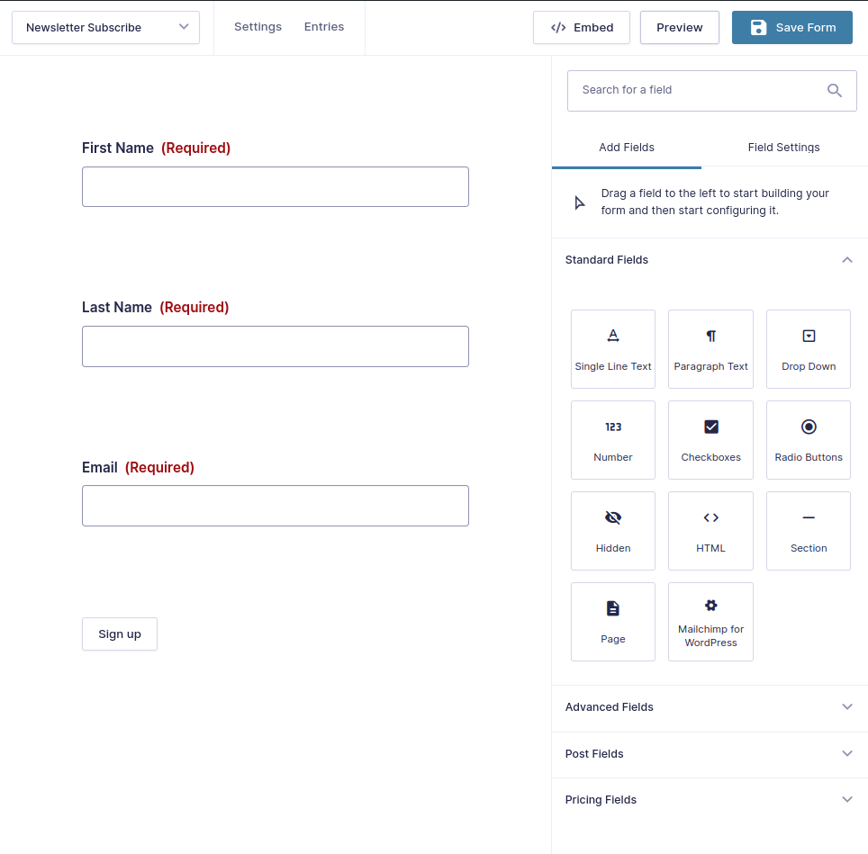
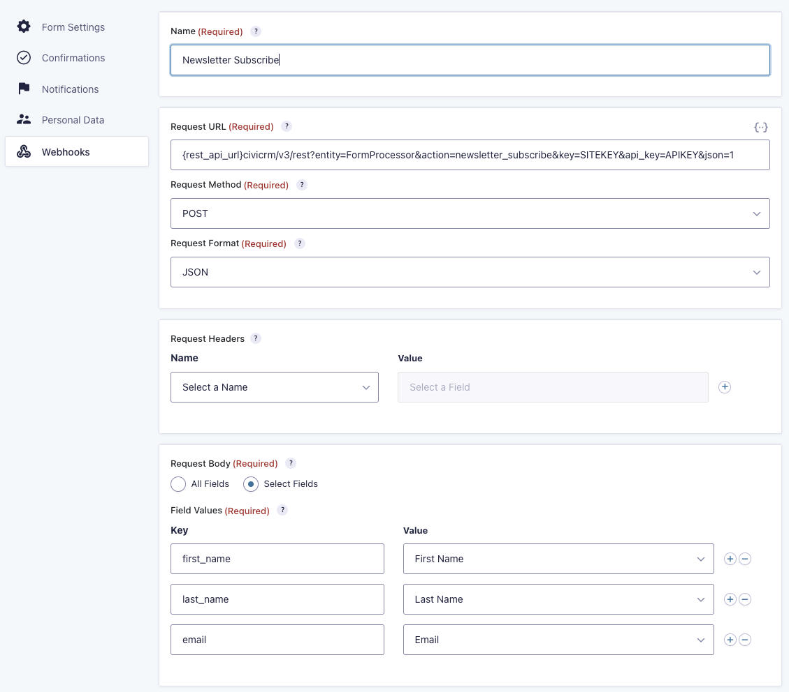

# Example: a newsletter subscription form

Use the following steps to set up a _Newsletter Subscription_ form using the example configuration provided.

1. Install this plugin and the CiviCRM extensions it needs, as described in [Installation](installation.md).
2. In CiviCRM, locate the CiviCRM "System User" Contact. This is the user account used to execute CiviCRM cron and scheduled jobs. If you do not have such a user, then best to create one is now as this will be used by default for processing the form submissions; this user must have a corresponding WordPress user account.
3. Open this CiviCRM Contact and click on the **API Key** tab.
4. Generate a **User API Key** and copy the **Site API Key**.
5. In WordPress, open Gravity Forms and import the example Gravity Form, [gravityforms-newsletter_subscribe.json](../example/gravityforms-newsletter_subscribe.json)
6. Open the imported Gravity Form, the following form should be displayed. 
7. Click on **Webhooks**
8. Add a new **Webhook**
9. Configure the **Webhook**
10. Configure the Webhook as shown below. 
11. In the **Request URL** parameters for the Webhook, replace the following values:
    1. `{rest_api_url}` - This Gravity Forms, Webhook, Merge Tag will return the WordPress REST endpoint, for example: https://bananas.org.au/wp-json/. Alternatively use `{gf_civicrm_rest_url}`, see [{gf_civicrm_rest_url} custom merge tag](remote-civicrm.md#gf_civicrm_rest_url-custom-merge-tag).
    3. `key`, enter the **CiviCRM Site API Key**. It is recommended to use the CiviCRM Site Key field in the Gravity Forms CiviCRM Settings page (`/wp-admin/admin.php?page=gf_settings&subview=gf-civicrm`) so the key can remain consistent across all Request URLs by using the `{gf_civicrm_site_key}` merge tag.
    4. `api_key`, enter the **CiviCRM API Key** It is recommended to use the CiviCRM API Key field in the Gravity Forms CiviCRM Settings page (`/wp-admin/admin.php?page=gf_settings&subview=gf-civicrm`) so the key can remain consistent across all Request URLs by using the `{gf_civicrm_api_key}` merge tag.
    5.  Example URL: `{rest_api_url}civicrm/v3/rest?entity=FormProcessor&action=newsletter_subscribe&key={gf_civicrm_site_key}&api_key={gf_civicrm_api_key}&json=1`
    6. `{gf_civicrm_site_key}` and `{gf_civicrm_api_key}` are only replaced in Gravity Forms Webhooks requests (Request URL, headers and body). Anywhere else, such as confirmations, notifications or field default values, they are output as-is, so the keys cannot be exposed.
12. Save the Webhook
13. In CiviCRM, go to the Administer > Automation > Form Processors page, `/wp-admin/admin.php?page=CiviCRM&q=civicrm%2Fadmin%2Fautomation%2Fformprocessor%2F#/formprocessors`
14. Import example Form Processor, [civicrm-form-processor-newsletter_subscribe.json](../example/civicrm-form-processor-newsletter_subscribe.json)
15. **Edit** the imported Form Processor. Verify that it has the required fields:
    1. first_name
    2. last_name
    3. email
16. In the Form Processor, edit the **Add to group** action and select the CiviCRM Group that the Contact should be subscribed to for the **Contact: Add to group**. This option must be set for the **Add to group** action to succeed.
17. Note that the Form Processor has the name, **newsletter_subscribe** which used in the Webhook, Request URL. This is how the Webhook is **connected** to this Form Processor.
18. **Save** the Form Processor.
19. In WordPress, embed the Gravity Form in a new page.
20. Open a new Web Browser window, not logged into the website. Go to the new page and submit the Gravity Form.
21. In CiviCRM, confirm that the Contact was created and that the Contact was subscribed to the Group in CiviCRM.
